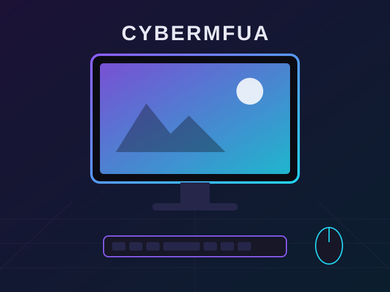
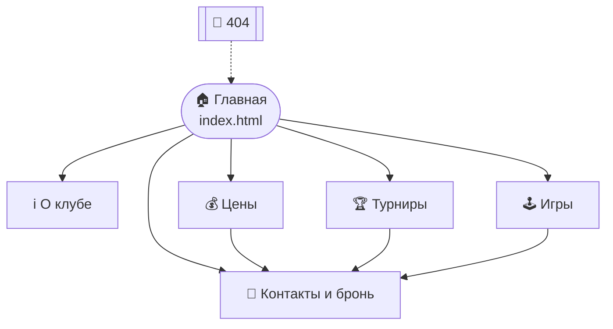
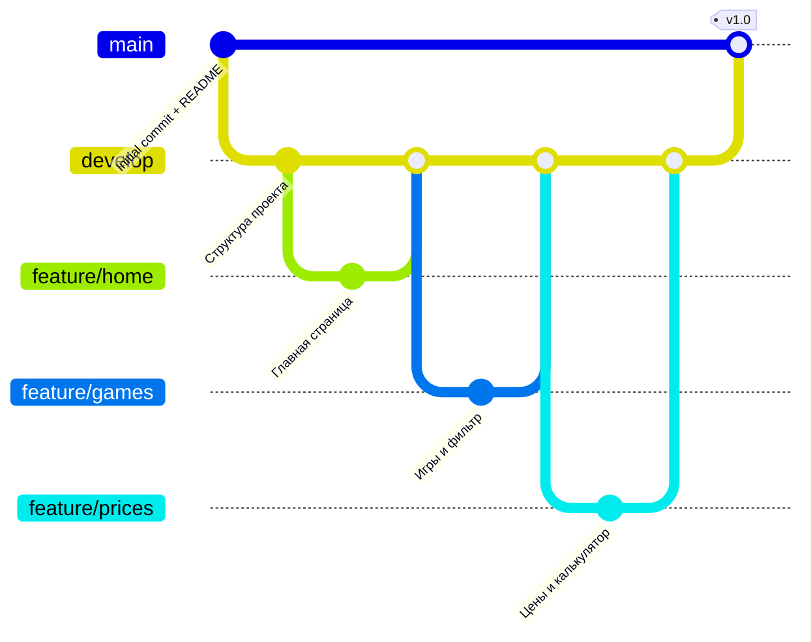

<div align="center">


# 🎮 Cybermfua

**Сайт компьютерного клуба нового поколения**


🌐 **Сайт:** https://sirexu.github.io/Cybermfua/
📦 **Репозиторий:** https://github.com/SiReXu/Cybermfua



</div>

---

## 📖 О проекте

Учебный командный проект: статический сайт компьютерного (игрового) клуба **Cybermfua** на HTML + CSS + JavaScript, разработанный в команде с использованием Git и GitHub (ветки, Pull Request-ы, code review).

## ✨ Возможности сайта

- 🏠 Главная страница с анимированными счётчиками и блоком преимуществ
- ℹ️ Страница «О клубе»: миссия, история (timeline), команда
- 🕹️ Библиотека игр с **фильтром по жанрам** (JavaScript)
- 💰 Тарифы и **калькулятор стоимости** со скидками
- 🏆 Расписание турниров
- 📝 Форма бронирования с **валидацией** на JS
- 📱 Адаптивная вёрстка (телефон, планшет, ПК), бургер-меню
- 🚫 Собственная страница 404

## 📄 Страницы

| Страница | Файл | Описание |
|---|---|---|
| Главная | `index.html` | Hero, статистика, зоны, призыв к действию |
| О клубе | `about.html` | Миссия, история, команда |
| Игры | `games.html` | Каталог по жанрам + фильтр |
| Цены | `prices.html` | Тарифы, калькулятор, пакеты |
| Турниры | `events.html` | События и расписание |
| Контакты | `contact.html` | Форма брони, адрес, соцсети |
| 404 | `404.html` | Страница ошибки |

## 🗂️ Структура проекта

```text
Cybermfua/
├── 📄 index.html
├── 📄 about.html
├── 📄 games.html
├── 📄 prices.html
├── 📄 events.html
├── 📄 contact.html
├── 📄 404.html
│
├── 📁 css/
│   ├── 📄 reset.css          # Сброс стилей браузера
│   ├── 📄 style.css          # Основные стили
│   └── 📄 responsive.css     # Адаптивные стили
│
├── 📁 js/
│   ├── 📄 main.js            # Счётчики, фильтр игр, калькулятор
│   ├── 📄 menu.js            # Навигационное меню
│   └── 📄 form-validation.js # Валидация формы
│
├── 📁 images/                # Логотип, иллюстрации, иконки
│
├── 📄 README.md
├── 📄 .gitignore
└── 📄 sitemap.xml
```

## 🧭 Карта сайта (Mermaid)



## 🔀 Git-flow команды



| Ветка | Назначение |
|---|---|
| `main` | Стабильная версия (публикуется на GitHub Pages) |
| `develop` | Основная разработка |
| `feature/*` | Новые функции (необязательно) |
| `hotfix/*` | Срочные исправления (необязательно) |

## 👥 Команда

| Роль | Участник | Зона ответственности |
|---|---|---|
| 👑 Тимлид | Александр Аксёнов | Репозиторий, ревью, README, GitHub Pages |
| 💻 Программист 1 | Ян Соловьёв  | `index.html`, `about.html`, общие стили |
| 🧩 Программист 2 | Глеб Каменский | `games.html`, `prices.html`, JS |
| 🎨 Программист 3 | Варвара Алексеева | `events.html`, `contact.html`, валидация |


## 🚀 Запуск локально

```bash
git clone https://github.com/YOUR_USERNAME/Cybermfua.git
cd Cybermfua
# откройте index.html в браузере или используйте Live Server в VSCode
```

## 🌍 Публикация на GitHub Pages

1. Откройте репозиторий → **Settings** → **Pages**.
2. В разделе **Build and deployment** выберите **Source: Deploy from a branch**.
3. Branch: `main`, папка `/ (root)` → **Save**.
4. Через 1–2 минуты сайт появится по адресу `https://YOUR_USERNAME.github.io/Cybermfua/`.

## 🛠️ Рабочий процесс в команде

```bash
# 1. Подтянуть актуальную develop
git checkout develop
git pull origin develop

# 2. Создать свою ветку
git checkout -b feature/my-task

# 3. Работа, коммиты
git add .
git commit -m "feat: добавил страницу ..."

# 4. Отправить и открыть Pull Request в develop
git push origin feature/my-task
```

Когда `develop` стабильна, тимлид делает Pull Request `develop → main`.

## 📜 Лицензия

Учебный проект. Все данные клуба (адреса, телефоны, цены) вымышленные.
